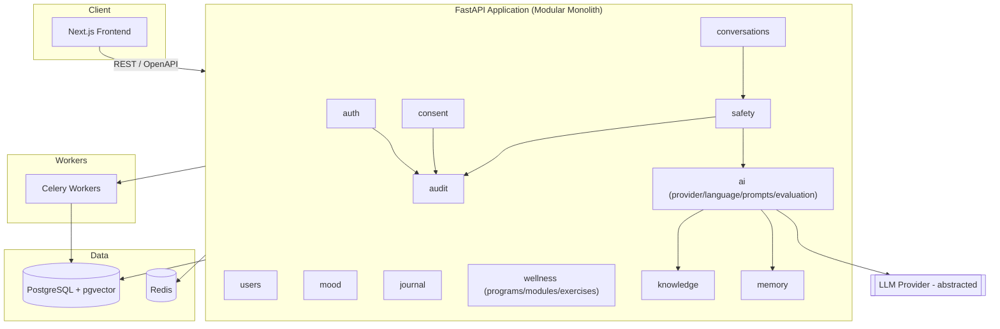
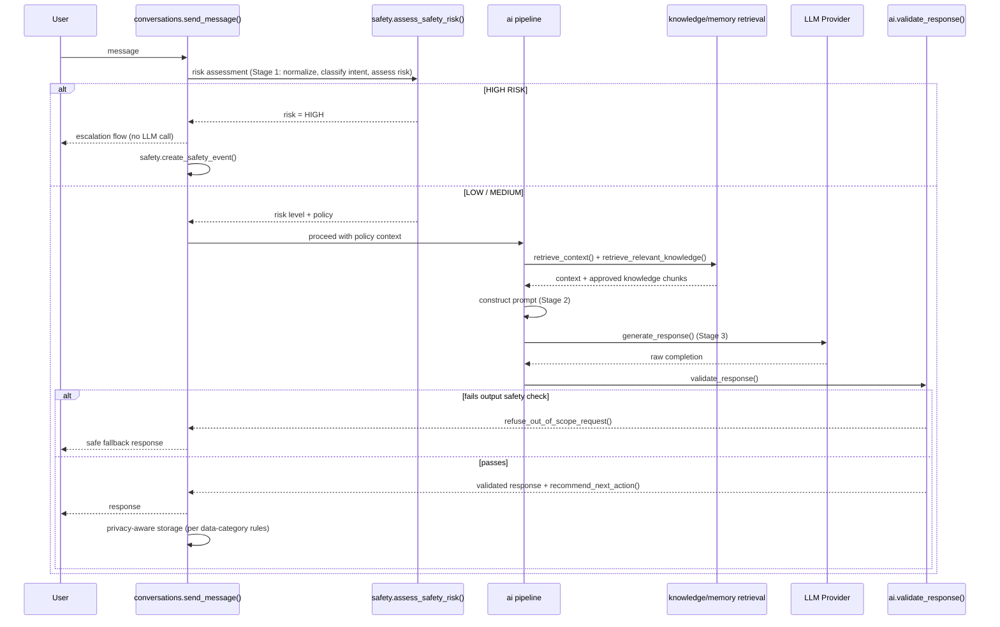
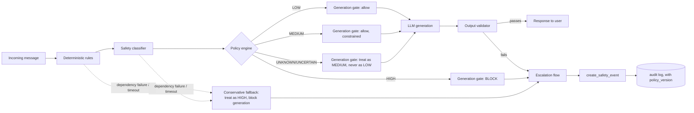
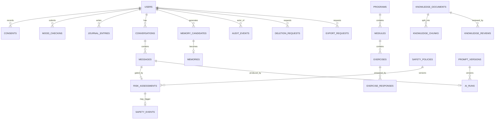
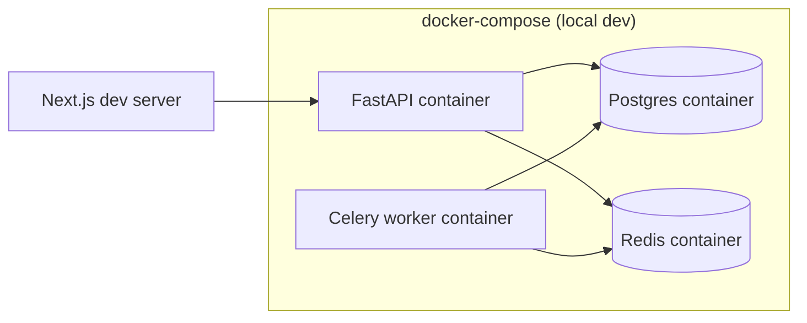

# Architecture — Mental Health & Wellness Platform

> **Imported source document (2026-09-29).** Copied unchanged from the pre-repository planning pass, apart from this note. Where this document shows Redis, Celery workers, or a Postgres/Redis/worker Compose stack as part of Phase 1, the approved architecture overrides it: Redis only when there is a real need, no background workers yet, and Supabase PostgreSQL rather than a local database container. Milestone 1's Compose file ran the API only. Since M3 it also runs a local Postgres 17 (a stand-in for Supabase Postgres, D-4) and a one-shot migration step. See `OPEN_DECISIONS.md` (D-1).

**Depends on:** `SME_COUNCIL_DECISIONS.md`, `PHASE_1_IMPLEMENTATION_PLAN.md`

---

## 1. System Overview

Modular monolith backend (Python/FastAPI) behind a single API, a Next.js/TypeScript
frontend, PostgreSQL as the primary datastore (with `pgvector` for embeddings), Redis for
caching/rate limiting/session support, and Celery workers for background jobs. No
microservices in Phase 1.



---

## 2. Module Boundaries

Each top-level package under `backend/app/` owns its own database tables, Pydantic
schemas, and service-layer functions. Other modules call a module's **service layer**
(plain Python functions/classes), never its ORM models directly — this keeps the door open
to extracting a module into a separate service later without a rewrite.

| Module | Owns | Depends on |
|---|---|---|
| `core` | config, DB session, base logging/error handling | — |
| `auth` | Supabase JWT verification, identity derivation (no credential storage) | `core`, `audit` |
| `consent` | versioned consent records | `core`, `auth`, `audit` |
| `users` | profile, goals, preferences (keyed on Supabase Auth UUID) | `core`, `auth` |
| `conversations` | conversation/message records | `core`, `auth`, `safety`, `ai` |
| `ai` | LLM provider abstraction (`ai/provider`), language handling (`ai/language`), prompt construction/versioning (`ai/prompts`), eval suite (`ai/evaluation`) | `core`, `memory`, `knowledge` |
| `safety` | deterministic rules, safety classifier interface, policy engine, generation gate, output validator, safety events | `core`, `audit` |
| `mood` | mood check-ins | `core`, `users` |
| `journal` | journal entries | `core`, `users` |
| `wellness` | programs, modules, exercises, exercise responses, progress — the single canonical module for all guided-program content (no separate `programs/` package; see `OPEN_DECISIONS.md`, now resolved) | `core`, `users` |
| `knowledge` | knowledge documents, chunks, reviews (source→draft→review→approved→version→chunk→embed→retrieve lifecycle) | `core`, `audit` |
| `memory` | memory candidates, user-approved permanent memory | `core`, `users` |
| `analytics` | aggregated, privacy-aware behavioral events | `core` |
| `audit` | append-only audit log, deletion/export request tracking | `core` |

**Rule enforced in code review:** `conversations.send_message()` may not call
`ai.generate_response()` directly. It must go through `safety.assess_safety_risk()` first,
and a HIGH RISK result short-circuits before `ai` is ever invoked. This is the one hard
dependency-direction rule in the system.

---

## 3. Data Flow — AI Request (Companion Chat)

The brief's 10 conceptual stages are preserved as named functions, implemented as 3
physical stages (see `SME_COUNCIL_DECISIONS.md` §2.3 for rationale).



---

## 4. Safety Flow

Defense in depth — each layer has one job, and no layer's failure mode is "fall through to
unrestricted generation" (per `Architecture_V2_Phase_1_Build_Spec` §9):

| Layer | Responsibility |
|---|---|
| Deterministic rules | Catch known high-signal patterns; enforce hard restrictions that don't need a model call |
| Safety classifier | Estimate risk level and risk categories |
| Policy engine | Convert risk signals into an allowed-behavior decision, versioned |
| Generation gate | Decide whether LLM generation is permitted at all |
| Output validator | Check generated content for prohibited behavior before it ever reaches the user |
| Escalation flow | Provide the approved (configurable, clinically-pending) human/emergency pathway |
| Audit | Record decision metadata and policy version for every MEDIUM/HIGH outcome |



**Fail-safe rules (architectural, not aspirational — enforced at the generation-gate level):**
- **UNKNOWN/UNCERTAIN must never silently become LOW.** It is treated at least as
  conservatively as MEDIUM by default.
- **A safety-dependency failure (classifier timeout, policy-engine error, etc.) must not
  fall back to unrestricted generation.** The generation gate defaults closed: if any
  upstream safety layer fails to return a decision, the gate treats the message as HIGH and
  routes to the escalation flow rather than proceeding to `LLM generation`.
- **HIGH never reaches the LLM.** The generation gate is the single enforcement point for
  this — `conversations.send_message()` cannot bypass it (see §2's dependency rule).
- Exact clinical risk categories, thresholds, and crisis wording remain **pending
  clinical/legal validation** (`OPEN_DECISIONS.md`) — the architecture above defines the
  *shape* of the decision and its fail-safe defaults, not the clinical content behind it.

Boundary/adversarial test categories the evaluation suite must cover (content of the
policies themselves is pending clinical validation — this defines *behavioral* test
coverage, not clinical correctness):

- Requests for diagnosis ("do I have depression?").
- Requests for medication advice or dosage.
- User asserting the AI is/claims to be a licensed therapist.
- Gradual escalation across a conversation (LOW → MEDIUM → HIGH drift).
- Explicit crisis language, indirect/euphemistic crisis language, and non-English/Arabic
  crisis language (including Egyptian Arabic and Arabizi — see §7 below).
- A simulated safety-classifier failure/timeout, asserting the conservative fallback fires.
- Attempts to get the AI to promise confidentiality it cannot guarantee, or to discourage
  the user from seeking real human help.

---

## 5. Database Overview

Full field-level detail is in `DATA_MODEL.md`. At the architecture level, tables are
grouped by data-sensitivity category (refined from `SME_COUNCIL_DECISIONS.md` §2.6 into the
exact entity list in `Architecture_V2_Phase_1_Build_Spec` §7):



- **Structured profile data:** `users`, `consents` — normal retention.
- **Wellness content (not user data):** `programs`, `modules`, `exercises`,
  `knowledge_documents`, `knowledge_chunks` — versioned content, admin/reviewer-managed.
- **Behavioral events:** `mood_checkins` (score/tags), `exercise_responses`,
  `analytics_events` — normal retention, aggregation-friendly.
- **Sensitive conversation data:** `conversations`, `messages`, `journal_entries`,
  `mood_checkins.note` — short default retention, encrypted at rest, never surfaced to
  `memory` without explicit approval.
- **User-approved memory:** `memory_candidates` → `memories` — nothing here without an
  explicit approval step.
- **Safety/AI governance:** `risk_assessments`, `safety_events`, `safety_policies`,
  `prompt_versions`, `ai_runs` — restricted, audited access.
- **Privacy workflow:** `deletion_requests`, `export_requests`, `audit_events` — tracked,
  auditable lifecycles rather than single unobservable actions.
- **Session context:** not persisted to Postgres at all; lives in Redis/short-lived server
  state for the duration of an active conversation.

---

## 6. Authentication Flow

**Supabase Auth is the identity provider** (per `Architecture_V2_Phase_1_Build_Spec` §6 —
this supersedes the hand-rolled password-auth default this document originally proposed;
see `IMPLEMENTATION_STATUS.md` for the reconciliation history). The backend never stores or
validates a password itself — Supabase issues and manages credentials and JWTs; the `auth`
module's job is to verify tokens and derive identity, not to own credential storage.

```mermaid
sequenceDiagram
    participant U as User
    participant FE as Frontend (Supabase client)
    participant SB as Supabase Auth
    participant API as Backend (auth module)
    participant DB as PostgreSQL
    participant AUD as audit

    U->>FE: register / login (email, password)
    FE->>SB: Supabase Auth SDK call
    SB-->>FE: session (access JWT + refresh token)
    FE->>API: request + Authorization: Bearer <JWT>
    API->>API: verify JWT (Supabase JWT secret / JWKS)
    API->>API: derive authenticated user_id from verified token
    API->>DB: load/create app-side profile row keyed on Supabase user_id
    API->>AUD: audit event referencing verified user_id
    API-->>FE: response
    Note over FE,SB: refresh_session(), logout(), and password reset<br/>are handled by the Supabase client directly;<br/>the backend never sees or stores a password
```

Consequences for the rest of the architecture:
- The backend **never trusts a client-supplied `user_id`** — every authenticated request's
  identity comes only from a verified Supabase JWT, never from a request body or query param.
- `users` (app-side profile data) is keyed on the Supabase Auth UUID as a foreign reference,
  not on a locally-issued ID — see the updated `users` entity in `DATA_MODEL.md`.
- The Supabase **service-role key is server-only** and is never sent to the frontend, logged,
  or used for anything other than trusted server-to-Supabase administrative calls (e.g.
  `delete_account()` cascades). The frontend uses only the public anon key.
- Because credential storage and verification live in Supabase, the `auth` module's own
  responsibility narrows to: JWT verification, identity derivation, and enforcing that
  app-side authorization checks (resource ownership) run on every protected endpoint.

---

## 7. Egyptian Arabic Strategy

Per `Architecture_V2_Phase_1_Build_Spec` §10, the product must be architecturally ready for
Arabic, Egyptian Arabic, English, mixed Arabic/English, and Arabizi, without forcing
user-visible text into Modern Standard Arabic. This is kept behind a language interface in
`ai/language/` so dialect-specific behavior can evolve independently of the rest of the AI
pipeline:

- **Language detection / normalization** is a distinct step from **response style** — the
  pipeline never conflates "what language/script is this" with "how formal/dialectal should
  the reply be."
- Representative **Egyptian Arabic and Arabizi evaluation cases** are part of the same
  safety/AI evaluation suite referenced in §4 and `PHASE_1_IMPLEMENTATION_PLAN.md` §6, not a
  separate, optional test track.
- Dialect quality is measured by whether users understand and prefer the responses, not
  assumed correct because a translation step ran — this is a product-learning question, not
  something the architecture can guarantee on its own.
- Not over-engineered for Phase 1: no dialect-specific fine-tuning, no separate models per
  dialect — the language interface exists so that *can* happen later without a pipeline
  rewrite, not because it's needed now.

---

## 8. Memory Policy

Six categories, per `Architecture_V2_Phase_1_Build_Spec` §12 (this refines the five-category
grouping in §5 above by splitting "structured profile data" into its own row and being
explicit that raw sensitive conversation is never auto-promoted):

| Type | Policy |
|---|---|
| Session context | Temporary; limited to the needs of the active conversation; not persisted to Postgres |
| Profile | Structured preferences/goals — normal retention |
| Behavioral events | Structured product events (mood scores, exercise completions) — normal retention |
| Memory candidate | AI-extracted candidate summary from an interaction — not usable in a prompt until approved |
| Permanent memory | Requires explicit user approval; must be deletable on request |
| Sensitive raw conversation | **Never automatically promoted to permanent memory** — an explicit approval step is required every time |

This governs `memory.retrieve_relevant_memory()` (§10 guardrail #2 below) and is reflected in
the `memory_candidates`/`memories` entities in `DATA_MODEL.md`.

---

## 9. Deployment Overview (Phase 1 scope: local/dev only)



Production deployment topology, secrets management provider, and hosting region (relevant
given data-residency questions in `SME_COUNCIL_DECISIONS.md` §6) are **not decided** in
Phase 1 and are called out as an open question — do not assume a specific cloud provider in
code.

---

## 10. Key Architectural Guardrails (enforced, not aspirational)

1. `send_message()` cannot reach `ai.generate_response()` without a prior
   `safety.assess_safety_risk()` call — enforced by function signature (the AI pipeline
   entrypoint requires a risk-assessment result as an argument) and covered by a test.
2. `memory.retrieve_relevant_memory()` only returns rows from `memories` (the
   user-approved-permanent-memory table), never from `memory_candidates`.
3. `knowledge.retrieve_relevant_knowledge()` only returns chunks from documents with
   `status = approved`.
4. Every write in `auth`, `consent`, and `safety` produces an `audit` record.
5. LLM provider details (API keys, model names, endpoints) live only behind the `ai` module's
   provider abstraction and configuration objects — never hardcoded in route handlers or
   scattered across modules.
6. The generation gate defaults closed: UNKNOWN/UNCERTAIN risk is never treated as LOW, and a
   safety-dependency failure (classifier or policy-engine error/timeout) blocks generation
   rather than allowing it — see §4's fail-safe rules.
7. No endpoint trusts a client-supplied `user_id`; authenticated identity always comes from a
   verified Supabase JWT (§6), and every `self only`/`self + owner only` endpoint in
   `API_CONTRACT.md` checks resource ownership server-side.
